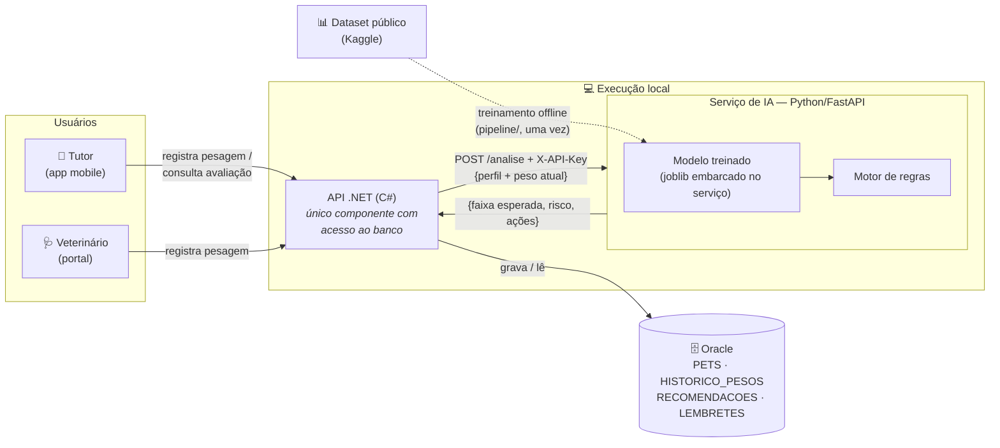
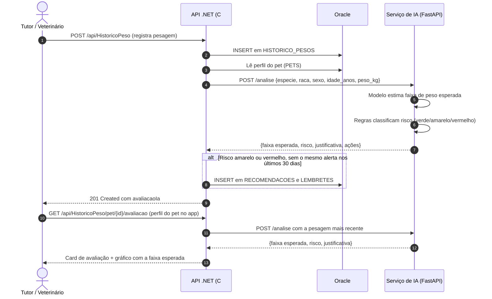
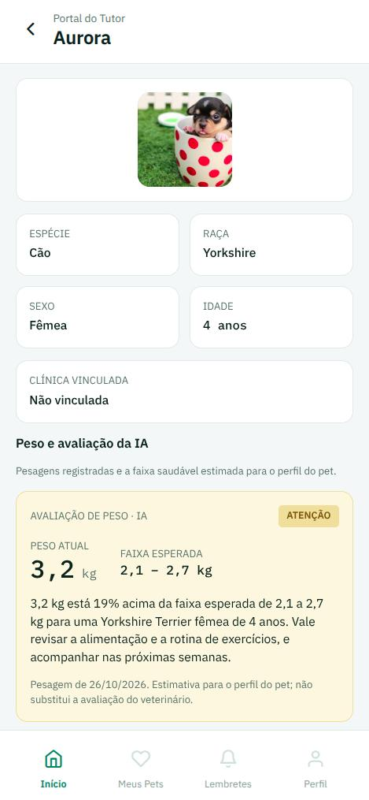
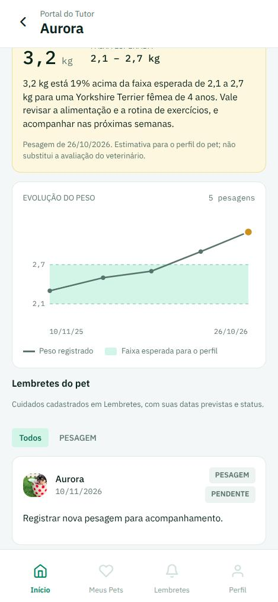

<h1>
  
  &nbsp;Fidelis — Componente de Inteligência Artificial
</h1>

**Projeto:** Fidelis — Gestão de Saúde Pet (React Native/Expo)

**Equipe:** Driven Soft · Challenge FIAP 2026 · Parceria CLYVO VET

**Entrega:** 4º Sprint — Disruptive Architectures: IoT, IoB & Generative IA (implementação e integração). O planejamento do componente foi entregue na 3º Sprint e está preservado nas seções 1 a 6.

**Repositório no Github:** https://github.com/Driven-Soft/Fidelis-IOT-IA

**Link do Vídeo Pitch (4º Sprint):** _adicionar o link do YouTube (não listado)_

**Link do Vídeo Pitch (3º Sprint):** https://youtu.be/LsMuxc3TqE0

**Repositórios integrados:** [FidelisApi-NET](https://github.com/Driven-Soft/FidelisApi-NET) (API .NET) · [FidelisMobile](https://github.com/Driven-Soft/FidelisMobile) (app React Native)

### Integrantes

| Nome | RM |
| --- | --- |
| Felipe Bezerra Beatrici | RM 564723 |
| Max Hayashi Batista | RM 563717 |
| Henrique Cunha Torres | RM 565119 |
| Yasmin Nathalin Miranda dos Santos | RM 561365 |
| Lucas da Silva Lima | RM 562118 |

## Sumário

**[Visão geral: como o módulo de IA funciona](#visão-geral-como-o-módulo-de-ia-funciona)**

**Planejamento (3º Sprint)**

1. [Problema de negócio tratado pela IA](#1-problema-de-negócio-tratado-pela-ia)
2. [Contribuição da IA: personalização, priorização e apoio à decisão](#2-contribuição-da-ia-personalização-priorização-e-apoio-à-decisão)
3. [Abordagem de IA adotada e justificativa](#3-abordagem-de-ia-adotada-e-justificativa)
4. [Dados: origem, estrutura e utilização](#4-dados-origem-estrutura-e-utilização)
5. [Fluxo de dados e arquitetura de integração](#5-fluxo-de-dados-e-arquitetura-de-integração)
6. [Síntese](#6-síntese)

**Implementação (4º Sprint)**

7. [O que foi implementado](#7-o-que-foi-implementado)
8. [Estrutura do repositório](#8-estrutura-do-repositório)
9. [Tecnologias utilizadas](#9-tecnologias-utilizadas)
10. [Como executar](#10-como-executar)
11. [Contrato da API do serviço](#11-contrato-da-api-do-serviço)
12. [Integração com a API .NET e o app](#12-integração-com-a-api-net-e-o-app)
13. [Testes e validação](#13-testes-e-validação)
14. [Resultados](#14-resultados)
15. [Evidências de funcionamento](#15-evidências-de-funcionamento)
16. [Limitações e próximos passos](#16-limitações-e-próximos-passos)

---

## Visão geral: como o módulo de IA funciona

Esta seção explica o componente de forma resumida e sem pré-requisitos. Os detalhes técnicos estão nas seções seguintes.

### O app e onde a IA entra

O **Fidelis** é um aplicativo de saúde pet com dois portais. No **portal do tutor**, o dono acompanha os pets, os cuidados com data prevista (vacinas, consultas, pesagens) e o histórico. No **portal do veterinário**, a clínica cadastra os pets e organiza esses cuidados. O objetivo é tirar o cuidado do modo reativo, em que o tutor só procura a clínica quando algo já deu errado.

O módulo de IA cuida de um ponto específico dessa jornada: **o peso do animal**. O tutor quase nunca sabe qual é o peso saudável do seu pet, porque ele depende da espécie, da raça, do sexo e da idade. Um Yorkshire adulto saudável pesa perto de 2,5 kg; um Labrador, mais de 30 kg.

Na prática, funciona assim:

1. Uma pesagem é registrada no app e chega à **API .NET** (`POST /api/HistoricoPeso`), que grava o peso no banco.
2. Logo em seguida, a API .NET envia o perfil do pet e o peso ao **serviço de IA em Python** (`POST /analise`).
3. O serviço de IA estima **qual deveria ser a faixa de peso saudável** para aquele perfil, compara com o peso registrado e classifica o resultado em 🟢 adequado, 🟡 atenção ou 🔴 alerta.
4. Se houver atenção ou alerta, o **serviço de IA cria a recomendação**: o texto e as ações a registrar (uma recomendação e um lembrete de nova pesagem em 15 dias ou de consulta em 7 dias).
5. A **API .NET grava** no banco a recomendação e o lembrete que recebeu do serviço de IA.
6. No perfil do pet, o tutor vê o resultado, um gráfico da evolução do peso com a faixa saudável e o lembrete na lista de cuidados.

O tutor não precisa pedir nada: a análise acontece sozinha a cada pesagem.

**Quem cria a recomendação é o serviço de IA, não a API .NET.**

| Quem | Método | Papel |
|---|---|---|
| Serviço de IA (`servico_ia/`) | `analise()` em `main.py` e `avaliar()` em `regras.py` | Obtém a faixa pelo modelo treinado, classifica o risco e monta o texto e as ações da recomendação |
| API .NET | `AnalisePesoService.AnalisarPesagem()` | Chama o serviço de IA e grava em `RECOMENDACOES` e `LEMBRETES` o que recebeu, sem repetir o mesmo alerta em 30 dias |

A API não calcula risco nem escreve texto, e o serviço de IA não acessa o banco.

> **Exemplo — Aurora, Yorkshire fêmea de 4 anos.** A faixa saudável estimada para ela é de 2,1 a 2,7 kg. Pesagens de 2,3, 2,5, 2,6 e 2,9 kg ficam verdes (até 10% além da faixa é tolerado). Quando ela chega a 3,2 kg, fica 19% acima: o app mostra **atenção**, sugere revisar alimentação e exercícios e agenda uma nova pesagem para 15 dias depois.

### De onde vêm os dados

Há dois tipos de dado, com papéis diferentes.

**Dados de treino — para a IA aprender o que é um peso normal.** O modelo aprendeu com dois datasets públicos do Kaggle: [Dogs Dataset](https://www.kaggle.com/datasets/waqi786/dogs-dataset-3000-records) (cães) e [Cats Dataset](https://www.kaggle.com/datasets/waqi786/cats-dataset) (gatos). Cada linha é um animal, com raça, idade, sexo e peso. Os arquivos originais estão em `data/`.

Ao auditar esses dados, a equipe percebeu que a coluna de peso era aleatória, com Yorkshires de dezenas de quilos, por exemplo. Por isso, o pipeline recalcula o peso de cada animal dentro da faixa oficial da sua raça e do seu sexo, segundo os padrões raciais das associações AKC/FCI (cães) e TICA/CFA (gatos). O resultado é a base de treino `data/fidelis_training_dataset.csv`: **3.990 animais de 83 raças** (2.995 cães e 995 gatos).

**Dados de uso — os pets reais do app.** Na hora de avaliar um pet, a IA usa o que já existe no banco do Fidelis:

| Tabela | O que é usado |
|---|---|
| `PETS` | Espécie, raça, sexo e data de nascimento (a idade é calculada a partir dela) |
| `HISTORICO_PESOS` | Peso e data da pesagem |
| `RECOMENDACOES` e `LEMBRETES` | É onde ficam gravados os resultados da IA |

Os dados dos pets reais **não são usados para treinar o modelo** e não saem da infraestrutura do Fidelis: o serviço de IA só recebe o perfil e o peso, devolve a avaliação e não guarda nada.

### Como os dados são processados, e que tipo de IA é esta

O processamento acontece em dois momentos.

**1. Treinamento — uma única vez, fora do app.** Os scripts da pasta `pipeline/` preparam os dados e treinam o modelo:

- **pandas** e **NumPy** limpam e unificam os datasets.
- **scikit-learn** treina o modelo: um **Gradient Boosting** (conjunto de árvores de decisão) que aprende a prever o peso típico de um animal a partir de espécie, raça, sexo e idade. As informações em texto, como a raça, viram números por *one-hot encoding*.
- Para cada combinação de espécie, raça e sexo, calcula-se a faixa em que estão 80% dos animais da base (do percentil 10 ao 90). Essa é a **faixa saudável esperada**, o mesmo princípio das curvas de crescimento usadas na veterinária.
- O modelo treinado é salvo com **joblib** em `servico_ia/modelo/` e vai junto com o serviço.

**2. Inferência — a cada pesagem.** O serviço de IA (`servico_ia/`) é uma API em **Python** com **FastAPI**. **Pydantic** valida os dados recebidos e **Uvicorn** é o servidor. Ele carrega o modelo já treinado e responde em milissegundos, sem treinar nada de novo.

**Tipo de IA.** É uma **IA híbrida**:

- **Aprendizado de máquina supervisionado (regressão):** o modelo aprendeu com exemplos rotulados (animais com peso conhecido) a estimar o peso esperado para cada perfil.
- **Sistema baseado em regras:** regras fixas e auditáveis transformam essa estimativa em uma decisão (verde, amarelo ou vermelho) e em ações.

**Não é IA generativa nem LLM.** Um modelo de linguagem não é confiável para contas com números e pode responder de jeitos diferentes à mesma pergunta. Para um alerta de saúde, a resposta precisa ser exata e reprodutível: o mesmo pet com o mesmo peso recebe sempre a mesma avaliação.

### Quem gera a recomendação, e como

A recomendação é gerada pelo **serviço de IA**, no **motor de regras** (`servico_ia/regras.py`), e passa por três peças até chegar ao tutor:

```
App (tutor ou veterinário)     API .NET                          Serviço de IA (Python)
──────────────────────────     ──────────────────────────        ─────────────────────────────
registra a pesagem        ──►  grava a pesagem no banco
                               envia perfil + peso         ──►   modelo estima a faixa saudável
                                                                 regras classificam o risco
                                                                 template monta o texto
                               recebe risco, texto e ações ◄──   devolve a avaliação
                               grava recomendação e lembrete
exibe card, gráfico      ◄──   entrega a avaliação ao app
e lembrete
```

Passo a passo, para a Aurora com 3,2 kg:

1. **Estimativa:** o modelo informa que a faixa esperada para uma Yorkshire fêmea de 4 anos é de 2,1 a 2,7 kg.
2. **Desvio:** as regras calculam quanto o peso passou da borda mais próxima da faixa. Aqui, (3,2 − 2,7) ÷ 2,7 = 19% acima.
3. **Classificação:**
   - até 10% além da faixa é 🟢 adequado;
   - de 10% a 20% é 🟡 atenção;
   - acima de 20% (para cima ou para baixo) é 🔴 alerta.

   Aqui, 19% dá **atenção**.
4. **Casos especiais:**
   - filhotes com menos de 1 ano só recebem avaliação informativa, porque ganhar peso é normal no crescimento;
   - pets sem raça definida são comparados à faixa geral da espécie, e por isso nunca chegam a alerta vermelho.
5. **Texto:** a frase é montada por um **modelo de texto com lacunas** preenchidas pelos números, nunca escrita livremente. Exemplo: *"3,2 kg está 19% acima da faixa esperada de 2,1 a 2,7 kg para uma Yorkshire Terrier fêmea de 4 anos. Vale revisar a alimentação e a rotina de exercícios, e acompanhar nas próximas semanas."* Assim, cada alerta pode ser conferido pelos números que o originaram.
6. **Ações:** junto com o texto, o serviço indica o que deve ser registrado: a recomendação e um lembrete de pesagem em 15 dias (no alerta vermelho, um lembrete de consulta em 7 dias).

A **API .NET** é quem grava essas ações no banco, porque o serviço de IA não acessa o banco. Ela também evita repetição: se o pet já recebeu o mesmo alerta nos últimos 30 dias, não grava outro igual. Se o serviço de IA estiver fora do ar, a pesagem é registrada normalmente, só sem avaliação.

O **app** apenas exibe o resultado: o card com o risco e o texto da recomendação, o gráfico com a faixa saudável e o lembrete na lista de cuidados do pet.

---

## 1. Problema de negócio tratado pela IA

O Fidelis quer tirar o cuidado com o pet do modo reativo, em que o contato com a clínica só acontece em emergências ou na vacinação. O componente de IA ataca um ponto específico e de alto impacto clínico: **identificar automaticamente quando o peso do animal está inadequado ao seu perfil**.

O peso é um dos indicadores mais sensíveis da saúde de cães e gatos. Sobrepeso está associado a diabetes e a doenças articulares e cardiovasculares; baixo peso costuma sinalizar doenças renais, endócrinas ou nutricionais. Mas o tutor raramente sabe qual é o peso saudável para a espécie, a raça, o sexo e a idade do seu pet, e o veterinário só avalia quando o animal chega à clínica.

A IA transforma cada pesagem em uma **avaliação automática de risco**, que vira recomendações e lembretes no app.

## 2. Contribuição da IA: personalização, priorização e apoio à decisão

- **Personalização:** não existe "peso certo" universal — um Yorkshire adulto pesa cerca de 2,5 kg, um Labrador passa de 30 kg. O modelo estima a faixa esperada **para o perfil de cada pet** (`Especie`, `Raca`, `Sexo` e idade).
- **Priorização:** cada pesagem recebe um nível de risco:

| Nível | Critério | Ação disparada |
|---|---|---|
| 🟢 Verde | Dentro da faixa, ou até 10% além da borda | Nenhuma |
| 🟡 Amarelo | De 10% a 20% além da faixa | `RECOMENDACOES` (`PESO_ATENCAO`) + `LEMBRETES` de pesagem em 15 dias |
| 🔴 Vermelho | Mais de 20% acima ou abaixo da faixa | `RECOMENDACOES` (`PESO_ALERTA`) + `LEMBRETES` de consulta em 7 dias |

- **Recomendação de serviços:** os alertas trazem o tutor de volta à clínica no momento certo, gerando recorrência qualificada para a CLYVO VET sem spam — o mesmo alerta não se repete em 30 dias.
- **Apoio ao veterinário:** a avaliação e a faixa de referência ficam disponíveis na API para o prontuário. É uma ferramenta de triagem: **a decisão clínica é sempre do veterinário**.
- **Histórico visual:** o gráfico de evolução do peso, com a faixa esperada sobreposta, mostra quando o peso começa a sair da faixa.

## Demonstração da funcionalidade

**Protótipo visual (3º Sprint):**

<table>
  <tr>
    <td align="center"><br /><sub>Perfil do Pet - Exemplo</sub></td>
    <td align="center"><br /><sub>Perfil do Pet - Exemplo com recomendação usando classificação do modelo</sub></td>
  </tr>
</table>

**Aplicação implementada (4º Sprint):** telas reais do app integrado à API .NET e ao serviço de IA, na [seção 15](#15-evidências-de-funcionamento).

## 3. Abordagem de IA adotada e justificativa

A abordagem é **híbrida: um modelo preditivo supervisionado, treinado com dados públicos (Kaggle), combinado com um motor de regras**.

- **Camada preditiva:** um modelo de regressão (scikit-learn), treinado uma única vez pelos scripts de `pipeline/`, estima a faixa de peso esperada para o perfil. O modelo é embarcado no serviço, então a inferência é determinística e instantânea, e **funciona desde a primeira pesagem**, sem precisar de histórico.
- **Camada de regras:** regras auditáveis transformam a estimativa em decisão: medem o desvio além da faixa (tolerância de 10%, alerta a partir de 20%, para excesso e para déficit) e geram recomendação e lembrete. Também tratam os casos especiais: pets SRD ou de raça fora da base usam a faixa da espécie e nunca chegam a vermelho, e filhotes com menos de 1 ano recebem avaliação apenas informativa. O texto é montado por template, nunca escrito livremente.

### Por que esta abordagem, e não as alternativas

O problema é numérico e estruturado: estimar um peso a partir de atributos e compará-lo a uma medição. Um **modelo supervisionado** é a ferramenta adequada, e o dataset público resolve a falta de histórico próprio no lançamento.

| Alternativa | Por que foi descartada |
|---|---|
| LLM / IA generativa | Não é confiável em cálculos, tem custo por chamada, depende de serviço externo e não dá respostas reprodutíveis |
| Sistema de recomendação clássico | Aprende preferências de muitos usuários sobre muitos itens, o que não é este problema |
| NLP | A entrada não é texto |
| Só regras, sem modelo | Exigiria cadastrar à mão faixas para centenas de combinações de raça, sexo e idade |

A combinação também é **explicável** (todo alerta mostra a faixa e o desvio), tem **custo próximo de zero** (sem APIs pagas) e preserva a **privacidade** (o treino usa só dados públicos).

### Fundamentação científica

A ideia de comparar o peso de cada animal com uma referência por raça, sexo e idade é o princípio das *growth standard charts* veterinárias, construídas com milhões de registros de cães: animais saudáveis raramente se afastam muito da referência do seu perfil (menos de 4% dos casos), enquanto o afastamento é frequente nos que têm condição corporal anormal (PLOS ONE, 2017 e 2020).

## 4. Dados: origem, estrutura e utilização

Os dados públicos servem para **treinar**; os dados do Fidelis servem para **avaliar** cada pet. Nenhuma das 14 tabelas do schema precisou mudar.

| Fonte | Campos | Papel na IA |
|---|---|---|
| Kaggle: [Dogs Dataset](https://www.kaggle.com/datasets/waqi786/dogs-dataset-3000-records) e [Cats Dataset](https://www.kaggle.com/datasets/waqi786/cats-dataset) (`data/*.zip`) | Raça, idade, sexo, peso | Treinamento offline do modelo |
| `PETS` | `Especie`, `Raca`, `Sexo`, `DataNascimento`, `TutorId` | Perfil do pet na inferência |
| `HISTORICO_PESOS` | `PesoKg`, `DataMedicao`, `PetId` | Peso avaliado (o mais recente) e gráfico de evolução |
| `RECOMENDACOES` | `Tipo`, `Descricao`, `DataRecomendacao`, `PetId` | Saída: risco em `Tipo`, justificativa em `Descricao` |
| `LEMBRETES` | `Tipo`, `Descricao`, `DataPrevista`, `TutorId`, `PetId` | Saída: pesagem em 15 dias ou consulta em 7 dias |

Na auditoria, a coluna de peso dos datasets originais se mostrou **aleatória** (Yorkshires com dezenas de quilos). Por isso, `pipeline/prepare_dataset.py` remove duplicatas, unifica as espécies e **recalibra os pesos pelas faixas oficiais de cada raça e sexo** (AKC/FCI para cães, TICA/CFA para gatos), gerando `data/fidelis_training_dataset.csv`: 3.990 animais de 83 raças, de forma reprodutível. No app, espécie e raça são texto livre ("Cão", "Yorkshire", "Vira-lata"); a API e o serviço de IA as normalizam antes da inferência.

## 5. Fluxo de dados e arquitetura de integração

O serviço de IA é **independente (Python + FastAPI, em container), stateless e sem acesso ao banco**: recebe os dados na requisição e devolve a avaliação. A API .NET é a única dona do banco e grava os resultados. A análise acontece **sob demanda**, a cada pesagem.

### Diagrama arquitetural



### Fluxo on-demand, passo a passo



A API e o serviço se autenticam pelo header `X-API-Key`, e o app nunca chama a IA diretamente. Se a IA estiver fora do ar, a pesagem é gravada mesmo assim.

**Por que essa arquitetura:** separar o serviço isola a stack de ciência de dados da stack .NET e permite retreinar o modelo sem mexer no backend, bastando publicar nova imagem. Sem banco, o serviço fica simples de publicar e de testar isoladamente. O treino com dados públicos resolve o *cold start*: a avaliação funciona desde a primeira pesagem de qualquer pet.

## 6. Síntese

| Requisito do Challenge | Resposta do Fidelis |
|---|---|
| Problema de negócio | Detectar peso inadequado ao perfil, trocando cuidado reativo por preventivo |
| Personalização e apoio à decisão | Faixa por perfil, risco em 3 níveis, recomendações e lembretes automáticos, avaliação para tutor e veterinário |
| Abordagem de IA | Modelo supervisionado (Kaggle) + motor de regras, com descarte fundamentado das alternativas |
| Dados | Kaggle para treino; `PETS` e `HISTORICO_PESOS` na inferência; `RECOMENDACOES` e `LEMBRETES` como saída, sem mudar o schema |
| Integração | Serviço FastAPI stateless em container, chamado pela API .NET a cada pesagem via REST |

---

## 7. O que foi implementado

Na 4º Sprint, o componente planejado foi implementado e integrado de ponta a ponta: app → API .NET → serviço de IA → banco.

| Planejado na 3º Sprint | Situação na 4º Sprint | Onde |
|---|---|---|
| Preparação e auditoria dos dados | ✅ Implementado e reprodutível | `pipeline/prepare_dataset.py`, `data/` |
| Modelo preditivo da faixa de peso por perfil | ✅ Treinado e avaliado | `pipeline/treinamento_modelo.py`, `servico_ia/modelo/` |
| Motor de regras (3 níveis, filhote, SRD, templates) | ✅ Implementado | `servico_ia/regras.py` |
| Serviço de IA stateless | ✅ FastAPI com `POST /analise`, `GET /health` e chave de API | `servico_ia/` |
| Integração com a API .NET | ✅ Análise a cada pesagem, gravação de `RECOMENDACOES` e `LEMBRETES`, resiliência e idempotência | [FidelisApi-NET](https://github.com/Driven-Soft/FidelisApi-NET) |
| Exibição ao tutor | ✅ Card de avaliação e gráfico de evolução com a faixa esperada no perfil do pet; lembrete da IA na lista de cuidados | [FidelisMobile](https://github.com/Driven-Soft/FidelisMobile) |
| Avaliação no prontuário do veterinário | 🟡 Disponível na API (`GET /api/HistoricoPeso/pet/{petId}/avaliacao`); a tela de prontuário do portal do veterinário no app ainda não foi construída | API .NET |

## 8. Estrutura do repositório

```
Fidelis-IOT-IA/
├─ data/                             # Dados
│  ├─ dogs_dataset.zip               #   Original do Kaggle — cães
│  ├─ cats_dataset.zip               #   Original do Kaggle — gatos
│  └─ fidelis_training_dataset.csv   #   Base de treinamento (3.990 registros, 83 raças)
├─ pipeline/                         # Preparação, treinamento e avaliação (offline)
│  ├─ prepare_dataset.py             #   Auditoria e recalibração → data/fidelis_training_dataset.csv
│  ├─ treinamento_modelo.py          #   Treinamento → servico_ia/modelo/modelo_faixa_peso.joblib
│  └─ avaliacao_modelo.py            #   Métricas e cenários → docs/RELATORIO_AVALIACAO.md
├─ servico_ia/                       # Serviço executável
│  ├─ main.py                        #   FastAPI: POST /analise, GET /health, chave de API
│  ├─ regras.py                      #   Motor de regras: limiares, casos especiais, templates
│  ├─ racas.py                       #   Normalização da raça digitada no app
│  ├─ modelo/
│  │  └─ modelo_faixa_peso.joblib    #   Modelo treinado, embarcado no serviço
│  ├─ tests/                         #   83 testes automatizados (pytest)
│  ├─ requirements.txt               #   Dependências de execução
│  ├─ requirements-dev.txt           #   + pytest e httpx (testes e pipeline)
│  └─ pytest.ini
└─ docs/
   ├─ RELATORIO_AVALIACAO.md         # Métricas, cenários validados e limitações
   └─ img/                           # Capturas do app integrado
```

## 9. Tecnologias utilizadas

| Tecnologia | Versão | Finalidade |
| --- | --- | --- |
| Python | 3.12 | Linguagem do serviço e do pipeline |
| FastAPI | 0.162 | API REST e documentação OpenAPI (Swagger) |
| Uvicorn | 0.54 | Servidor ASGI |
| scikit-learn | 1.9 | Modelo preditivo (Gradient Boosting quantílico) |
| pandas / NumPy | 3.1 / 2.5 | Preparação de dados e seleção de faixas |
| joblib | 1.6 | Serialização do modelo treinado |
| Pydantic | 2.14 | Validação do contrato de entrada |
| pytest | 9.1 | Testes automatizados |
| .NET 10 / ASP.NET Core | — | API que integra a IA ao app ([FidelisApi-NET](https://github.com/Driven-Soft/FidelisApi-NET)) |
| React Native / Expo | — | App do tutor ([FidelisMobile](https://github.com/Driven-Soft/FidelisMobile)) |

## 10. Como executar

### Pré-requisitos

- Python 3.12 ou superior

### Serviço de IA local

```bash
git clone https://github.com/Driven-Soft/Fidelis-IOT-IA.git
cd Fidelis-IOT-IA
python -m venv .venv
source .venv/bin/activate        # Windows: .venv\Scripts\activate
pip install -r servico_ia/requirements-dev.txt
cd servico_ia
uvicorn main:app --reload --port 8000
```

A documentação interativa (Swagger UI) fica em **http://localhost:8000/docs** — é por ela que se demonstra o serviço sem precisar de cliente HTTP.

Para exigir a chave de API, como na integração com a API .NET, suba com a variável definida e envie o header `X-API-Key` (no Swagger, botão **Authorize**):

```bash
FIDELIS_IA_API_KEY=minha-chave-local uvicorn main:app --port 8000
```

### Testes

```bash
cd servico_ia
pytest -v
```

### Pipeline de dados e treinamento

Os scripts rodam a partir da raiz do repositório e usam caminhos relativos a ele:

```bash
python pipeline/prepare_dataset.py      # data/*.zip → data/fidelis_training_dataset.csv
python pipeline/treinamento_modelo.py   # → servico_ia/modelo/modelo_faixa_peso.joblib
python pipeline/avaliacao_modelo.py     # → docs/RELATORIO_AVALIACAO.md
```

- **Preparação:** consome os datasets do Kaggle, remove duplicatas, unifica as espécies e recalibra os pesos por raça e sexo (seção 4).
- **Treinamento:** `GradientBoostingRegressor` com `loss="quantile"` estima o peso mediano a partir de espécie, raça, sexo e idade (one-hot nas categóricas); a faixa esperada vem dos quantis empíricos P10–P90 por espécie × raça × sexo, mais precisos nas caudas do que a regressão quantílica pura. Quando a raça existe na base sem amostra do sexo informado, a faixa é a mediana do modelo ± 15%.
- **Avaliação:** gera o relatório com métricas, faixas por perfil e a matriz de cenários do motor de regras.

### Sistema completo (IA + API + app)

1. Suba o serviço de IA localmente na porta 8000.
2. Na [FidelisApi-NET](https://github.com/Driven-Soft/FidelisApi-NET), configure a seção `FidelisAi` (`BaseUrl: http://localhost:8000`, `ApiKey` igual à `FIDELIS_IA_API_KEY`) e rode a API.
3. No [FidelisMobile](https://github.com/Driven-Soft/FidelisMobile), aponte `EXPO_PUBLIC_API_URL` para a API e abra o perfil de um pet com pesagens.

## 11. Contrato da API do serviço

### `POST /analise`

Avalia uma pesagem. Chamado pela API .NET logo após gravar o registro em `HISTORICO_PESOS`.

**Requisição**

```json
{
  "pet_id": 1,
  "especie": "Cachorro",
  "raca": "Yorkshire Terrier",
  "sexo": "F",
  "idade_anos": 4,
  "peso_kg": 3.2
}
```

| Campo | Tipo | Obrigatório | Origem no banco | Observação |
|---|---|---|---|---|
| `pet_id` | inteiro | sim | `PETS.Id` | Devolvido na resposta para correlação |
| `especie` | `"Cachorro"` \| `"Gato"` | sim | `PETS.Especie` | A API .NET normaliza o texto do cadastro; outras espécies não são enviadas |
| `raca` | texto ou `null` | não | `PETS.Raca` | Texto livre; apelidos em português são reconhecidos; `null`, SRD ou raça fora da base acionam o fallback |
| `sexo` | `"M"` \| `"F"` | sim | `PETS.Sexo` | — |
| `idade_anos` | decimal ≥ 0 | sim | derivado de `PETS.DataNascimento` | Aceita fração (0.5 = 6 meses) |
| `peso_kg` | decimal > 0 | sim | `HISTORICO_PESOS.PesoKg` | Medição mais recente |

**Resposta `200`**

```json
{
  "pet_id": 1,
  "perfil": {
    "especie": "Cachorro",
    "raca": "Yorkshire Terrier",
    "sexo": "F",
    "idade_anos": 4.0,
    "raca_na_base_de_referencia": true
  },
  "avaliacao": {
    "risco": "AMARELO",
    "tipo_recomendacao": "PESO_ATENCAO",
    "faixa_esperada_kg": { "min": 2.1, "max": 2.7 },
    "peso_informado_kg": 3.2,
    "desvio_alem_da_faixa": 0.185,
    "justificativa": "3,2 kg está 19% acima da faixa esperada de 2,1 a 2,7 kg para uma Yorkshire Terrier fêmea de 4 anos.",
    "acoes": [
      {
        "registro": "RECOMENDACAO",
        "tipo": "PESO_ATENCAO",
        "descricao": "3,2 kg está 19% acima da faixa esperada de 2,1 a 2,7 kg para uma Yorkshire Terrier fêmea de 4 anos. Vale revisar a alimentação e a rotina de exercícios, e acompanhar nas próximas semanas."
      },
      {
        "registro": "LEMBRETE",
        "tipo": "PESAGEM",
        "prazo_dias": 15,
        "descricao": "Registrar nova pesagem para acompanhamento."
      }
    ]
  }
}
```

| Campo da avaliação | Descrição |
|---|---|
| `risco` | `VERDE`, `AMARELO` ou `VERMELHO` |
| `tipo_recomendacao` | Valor para `RECOMENDACOES.Tipo`: `PESO_ADEQUADO`, `PESO_ATENCAO` ou `PESO_ALERTA` |
| `faixa_esperada_kg` | Faixa estimada para o perfil — exibida no app |
| `desvio_alem_da_faixa` | Desvio proporcional além da borda mais próxima (0 quando dentro da faixa) |
| `justificativa` | Diagnóstico numérico em texto, pronto para exibição |
| `acoes` | Lista do que persistir; vazia quando o risco é verde |

Na resposta, `perfil.raca` traz o nome reconhecido na base (ou `null` para SRD).

**Respostas de erro:** `422` para entrada inválida (campo ausente, espécie ou sexo fora do domínio, peso não positivo, idade negativa), no padrão de erro do Pydantic; `401` quando o serviço roda com `FIDELIS_IA_API_KEY` e o header `X-API-Key` está ausente ou incorreto.

### `GET /health`

Verificação de saúde do serviço (sempre pública), com as métricas do modelo carregado:

```json
{ "status": "ok", "metricas_modelo": { "mae_p50_kg": 1.51, "cobertura_p10_p90": 0.739 } }
```

## 12. Integração com a API .NET e o app

### API .NET ([FidelisApi-NET](https://github.com/Driven-Soft/FidelisApi-NET))

| Regra | Comportamento |
|---|---|
| Momento | Depois que a pesagem é gravada em `HISTORICO_PESOS` |
| Resiliência | Falha, timeout (3 s) ou IA desligada nunca invalidam a pesagem: a resposta é `201` com `avaliacaoIa: null` e o erro vai para o log |
| Idempotência | Se o pet já tem recomendação do mesmo `Tipo` nos últimos 30 dias, recomendação e lembrete não são repetidos; uma escalada de risco (atenção → alerta) gera novo registro |
| Pesagem retroativa | Só a pesagem mais recente do pet é analisada |
| Persistência | `RECOMENDACAO` → `RECOMENDACOES`; `LEMBRETE` → `LEMBRETES` com `DataPrevista` = data da análise + `prazo_dias` e `TutorId` de `PETS.TutorId` |
| Autenticação | Header `X-API-Key` configurado em `FidelisAi:ApiKey` |

| Método | Rota | Descrição |
|---|---|---|
| `POST` | `/api/HistoricoPeso` | Grava a pesagem e devolve a avaliação da IA em `avaliacaoIa` |
| `GET` | `/api/HistoricoPeso/pet/{petId}/avaliacao` | Avalia a pesagem mais recente sem gravar nada; `404` sem pesagens, `400` para espécie não avaliada, `503` com a IA indisponível |

Implementação: `AnalisePesoService` (orquestração), `FidelisAiClient` (cliente HTTP via `IHttpClientFactory`) e `FidelisAiExtensions` (configuração).

### App ([FidelisMobile](https://github.com/Driven-Soft/FidelisMobile))

No perfil do pet (`PetProfile`), a seção **Peso e avaliação da IA** mostra:

- **Card de avaliação:** risco (adequado, atenção ou alerta, nas cores da identidade visual), peso atual, faixa esperada e a recomendação montada pelo serviço de IA;
- **Gráfico de evolução:** pesagens no tempo com a faixa esperada sobreposta e o ponto mais recente na cor do risco;
- **Lembretes do pet:** o lembrete de pesagem ou consulta criado pela IA aparece na lista de cuidados.

## 13. Testes e validação

**Serviço de IA — 83 testes** (`servico_ia/tests/`, `pytest`):

- Cálculo do desvio e limiares de classificação, incluindo os valores de fronteira
- Cenários de uso: peso adequado, tolerância, atenção, alerta por excesso e por déficit
- Casos especiais: filhote em crescimento e pet sem raça definida
- Contrato do endpoint e validação de entrada (campos ausentes, domínios inválidos, valores não positivos)
- Personalização: perfis diferentes recebem faixas diferentes, e o mesmo peso recebe vereditos opostos em perfis distintos
- Normalização da raça digitada: apelidos em português, acentos e hífens, SRD por extenso, apelidos separados por espécie
- Chave de API: endpoint aberto sem a variável, `401` sem header ou com chave errada, `/health` sempre público
- Determinismo da saída

**Integração na API .NET — 36 testes** (28 unitários e 8 de integração): gravação das ações por risco, idempotência, falha da IA sem perder a pesagem, espécie não suportada, pesagem retroativa, JSON em snake_case do cliente HTTP e o endpoint de avaliação (200, 404, 400, 503).

**Validação ponta a ponta:** o fluxo completo foi executado com o serviço de IA local, a API .NET com banco em memória e o app na web. Para a pet de referência (Aurora, Yorkshire fêmea de 4 anos, cadastrada como "Cão" / "Yorkshire"), as pesagens 2,3 → 2,5 → 2,6 → 2,9 kg foram classificadas como verdes e a de **3,2 kg como amarela (19% acima da faixa de 2,1 a 2,7 kg)**; a API gravou a recomendação `PESO_ATENCAO` e o lembrete `PESAGEM` para 15 dias depois, e o app exibiu o card, o gráfico e o lembrete.

## 14. Resultados

Medidos sobre o conjunto de teste (798 registros, 20% da base, estratificado por raça):

| Métrica | Valor | Leitura |
|---|---|---|
| Erro absoluto médio (MAE) | **1,51 kg** | Erro típico da estimativa de peso mediano |
| Erro relativo médio | **9,8%** | Erro proporcional ao porte do animal |
| R² | **0,975** | Variância do peso explicada pelo perfil |
| Cobertura da faixa P10–P90 | **73,9%** | Pesagens dentro da faixa prevista (alvo teórico ~80%) |

| Espécie | Amostras (teste) | MAE | Erro relativo |
|---|---|---|---|
| Cachorro | 600 | 1,8 kg | 8,9% |
| Gato | 198 | 0,6 kg | 12,4% |

Exemplos de faixas aprendidas: Yorkshire Terrier fêmea 2,1–2,7 kg · Beagle macho 11,3–13,4 kg · Labrador Retriever macho 30,0–34,5 kg · Great Dane macho 67,1–88,1 kg · Siamese fêmea 2,6–3,8 kg · Maine Coon macho 8,0–10,7 kg.

**O mesmo peso, vereditos opostos:** 3,2 kg é 🟡 atenção para uma Yorkshire, mas 🔴 alerta (déficit) para um Beagle ou um Labrador — a avaliação é individualizada.

O relatório completo, com a matriz de cenários validados, as justificativas geradas e as limitações, está em [`docs/RELATORIO_AVALIACAO.md`](docs/RELATORIO_AVALIACAO.md).

## 15. Evidências de funcionamento

Capturas do app integrado à API .NET e ao serviço de IA, durante a validação ponta a ponta descrita na seção 13:

<table>
  <tr>
    <td align="center"><br /><sub>Perfil do pet com o card de avaliação da IA (atenção, 19% acima da faixa)</sub></td>
    <td align="center"><br /><sub>Evolução do peso com a faixa esperada e o lembrete criado pela IA</sub></td>
  </tr>
</table>

Outras evidências:

- [`docs/RELATORIO_AVALIACAO.md`](docs/RELATORIO_AVALIACAO.md) — métricas e matriz de cenários gerada pela execução real do modelo e do motor de regras
- Swagger do serviço (`/docs`) e da API .NET — demonstração interativa do `POST /analise` e do `POST /api/HistoricoPeso`

## 16. Limitações e próximos passos

- A base de treinamento deriva de datasets públicos cuja coluna de peso foi recalibrada por faixas de referência de raça; não substitui uma base clínica real, que é o próximo passo natural do produto (retreinar com as pesagens reais do Fidelis).
- Pets sem raça definida são avaliados pela faixa geral da espécie, o que detecta apenas desvios evidentes — por isso a classificação nesses casos é deliberadamente conservadora.
- A tela de prontuário do portal do veterinário ainda não consome a avaliação, já disponível na API.
- O componente avalia adequação do peso ao perfil; não é instrumento diagnóstico. A conduta clínica permanece com o veterinário.
